  

# 🚀 Awesome Augmented Reality (AR) Remote Assistance

  

  <strong>A curated index of top-tier Augmented Reality (AR) remote assistance platforms, enterprise visual guidance tools, smart-glasses telepresence solutions, and open-source spatial computing toolkits.</strong>

  <a href="#-sector-overview--market-dynamics">Sector Overview</a> •
  <a href="#-saas-products">SaaS Platforms</a> •
  <a href="#-open-source-projects--developer-sdks">Open-Source & SDKs</a> •
  <a href="#-key-use-cases">Use Cases</a> •
  <a href="#-star-history">Star History</a> •
  <a href="#-support">Support</a> •
  <a href="#-contributing">Contributing</a>

---

## 📖 Introduction & SEO Overview

**Augmented Reality (AR) Remote Assistance** bridges the gap between field technicians and remote specialists across manufacturing, telecom, healthcare, energy, and defense. By streaming interactive live video merged with **3D spatial telestration**, digital annotations, and hands-free heads-up displays (smart glasses), remote experts can guide frontline personnel through complex troubleshooting and maintenance tasks with zero travel overhead, near-zero downtime, and enhanced safety.

---

## 📊 Sector Overview & Market Dynamics

* **Estimated Market Size:** The dedicated AR remote assistance software market is valued at **$1.6 billion to $3.0 billion**, growing rapidly at a **20% to 35% CAGR** as part of the broader $100B+ enterprise augmented reality and mixed reality ecosystem.
* **Market Structure & Fragmentation:**
  * **Moderately Fragmented / Ecosystem Anchors:** Mega-cap tech leaders (Microsoft Dynamics 365 Remote Assist, TeamViewer Frontline/Assist AR, CareAR/Xerox/ServiceNow) capture wide deployment footprints by coupling AR assistance to foundational enterprise resource planning (ERP), IT service management (ITSM), and customer relationship management (CRM) contracts.
  * **Specialist / Industrial ISV Layer:** Independent software vendors (ISVs) like VSight, XMReality, Librestream, and Acty maintain significant market share by engineering purpose-built solutions for harsh industrial conditions, extreme low-bandwidth connections, intrinsically safe head-mounted tablets (e.g., RealWear Navigator, Vuzix Shield), and hands-free voice control.

---

## 💼 SaaS Products

Comprehensive comparison of industry-standard commercial Augmented Reality visual support and remote assistance software platforms.

| 🏢 Company / Product | 💳 Starting Price (Paid Tier) | 🎁 Free Tier / Trial Limits | 📈 Company Size (Revenue / Valuation) | ⚡ Key Capabilities |
| :--- | :--- | :--- | :--- | :--- |
| **Microsoft Dynamics 365 Remote Assist** | **$65/user/month** (standalone) or $20/user/month attach license | **90-day free trial** (up to 25 users; HoloLens, iOS, Android) | **$245B+ Annual Revenue** / ~$3.1T Market Cap | HoloLens mixed reality, Microsoft Teams cross-calling, 3D world-anchored annotations, Field Service integration. |
| **Zoho Lens** | **$10/technician/month** ($120 billed annually) for Standard Edition | **Forever-free plan** (limited to 1 technician, 1 simultaneous session, text chat & VoIP, technician AR annotations, offline recording) | **$1.4B+ Annual Revenue** / ~$10B–$12.5B Valuation | Browser-to-mobile AR video, freeze-frame mode, 3D directional arrows, Zoho CRM and Zoho Desk ticketing integration. |
| **TeamViewer Frontline / Assist AR** | **$310/year** (~$25.80/month equivalent, billed annually) for Assist AR Lite | **14-day free trial** (enterprise evaluation; Assist AR Lite trial with limited SMS invites) | **€671.4M (~$730M) Annual Revenue** / ~€2.0B Market Cap | Real-time 3D object tracking, OCR text extraction, multi-platform smart glasses support (Vuzix, RealWear, Google Glass). |
| **CareAR (Xerox)** | **$50/user/month** (Assist tier, billed annually in enterprise minimums) | **14-day free trial** (requires enterprise demo verification; proof-of-concept pilot) | **$700M Valuation** (ServiceNow strategic funding) / ~$6.8B Xerox Parent Revenue | Enterprise visual guidance, step-by-step spatial work instructions, ServiceNow ticketing and digital workflow integration. |
| **Splashtop AR** | **$259/concurrent technician/year** (SOS Standard tier baseline; AR add-on quote-based) | **7-day free trial** (full unattended/attended remote access trial, up to 2 concurrent sessions) | **$100M+ Annual Revenue** / $1.0B Valuation | Real-time AR annotations, mobile-to-mobile camera streaming, low latency, cross-platform field technician support. |
| **RealWear Cloud (Ari Business)** | **$9.90/device/month** ($118.80 billed annually) for Ari Pro Workspace | **Ari Core Forever-Free Plan** (supports unlimited devices with basic device setup, configuration, and Ari Chat) | **$45M+ Annual Revenue** / ~$150M Cumulative Funding | Industrial fleet telemetry and device management for assisted-reality smart glasses, remote screen view, OTA updates. |
| **Help Lightning** | **$75,000/year** (Enterprise tier, includes block of 200 user licenses) | **No self-service free tier or trial** (Evaluation via custom enterprise demo & tailored 30-day proof-of-concept) | **$3.2M+ Annual Revenue** / ~$36M Valuation | Merged Reality video streaming (hands superimposed into live view), spatial telestration, enterprise call center integration. |
| **VSight Remote** | **$240/month** (VSight Remote Expert baseline subscription) | **14-day free trial** (full access to VSight Remote expert workspace with guest web invite links) | **$2.1M Annual Revenue** / ~$8M–$10M Valuation | Real-time AR drawings, multi-party calls, low-bandwidth mode, PDF session reports, smart glasses support. |
| **XMReality** | **$35/user/month** ($420 billed annually) for Basic Plan | **14-day free trial** (no credit card required; full AR annotation features) | **$1.8M (SEK 19.8M) Annual Revenue** / ~$3.5M Market Cap | Hand overlay gestures, real-time spatial telestration, web client (guest access with no app download required). |
| **Acty (Icona Technology)** | **€165/month** (~$180/month, billed annually) for Core License | **15-day free trial** (full feature access, no credit card required) | **$4.0M (€3.7M) Annual Group Revenue** / ~€8M Market Cap | 3D object annotations, real-time voice translation across 60+ languages, automated intervention PDF summaries. |

---

## 🔓 Open-Source Projects & Developer SDKs

Community-driven repositories, proof-of-concept implementations, and open SDKs for constructing custom AR remote assistance, spatial annotations, and telepresence pipelines.

| 📦 Repository & Project | ⭐ Stars Badge | 🛠️ Tech Stack & Platform | 📝 Description |
| :--- | :--- | :--- | :--- |
| [**AgoraIO-Community/AR-Remote-Support**](https://github.com/AgoraIO-Community/AR-Remote-Support) |  | iOS, ARKit, Agora RTC SDK | AR remote support proof-of-concept (similar to Vuforia Chalk) enabling real-time video collaboration and 3D annotations over WebRTC. |
| [**limvi-licef/RemoteAssistanceAR**](https://github.com/limvi-licef/RemoteAssistanceAR) |  | Unity, HoloLens, UWP, WebRTC | Augmented reality remote assistance system designed for Microsoft HoloLens and Windows clients with spatial anchor guidance. |
| [**dalkofjac/RemoteAssistant**](https://github.com/dalkofjac/RemoteAssistant) |  | Android, Iristick AR, WebRTC | Remote assistance bridge connecting industrial Iristick smart glasses with modern web applications for hands-free video guidance. |
| [**kgediya/Remote-ARsistance**](https://github.com/kgediya/Remote-ARsistance) |  | Snap Spectacles, WebRTC | Real-time remote support utility developed for Snap AR Spectacles with live video streaming, voice chat, and interactive drawing annotations. |
| [**ShreenathManikandaswamy/Remote-Assistance**](https://github.com/ShreenathManikandaswamy/Remote-Assistance) |  | Unity, Vuforia, WebRTC | Mobile-to-mobile AR remote support application allowing an expert anywhere in the world to visualize camera feeds and project 3D marker annotations. |
| [**me-ZaidAli/RAT-AR**](https://github.com/me-ZaidAli/RAT-AR) |  | Unity, ARCore, Firebase | Remote Assistance Tool (RAT) powered by AR and cloud signaling for collaborative hardware troubleshooting and maintenance. |
| [**Codesmashershubh/Ghost-Hands**](https://github.com/Codesmashershubh/Ghost-Hands) |  | WebRTC, MediaPipe, Three.js | Real-time AR remote guidance tracking a remote expert's hand gestures client-side and overlaying them directly on the technician's live feed. |
| [**dalkofjac/smartglassy-demo-foi**](https://github.com/dalkofjac/smartglassy-demo-foi) |  | Angular, SignalR, Vuzix, Glass | WebRTC and SignalR remote assistance demo linking Android-based augmented reality glasses (Google Glass, Vuzix M400) to an Angular web desk. |

---

## 🎯 Key Use Cases

* 🏭 **Industrial Manufacturing & Assembly:** Guiding line operators through complex machinery setup, reducing Mean Time to Resolution (MTTR).
* 🔧 **Field Service & Utilities:** Empowering junior field technicians with senior expert guidance over low-latency cellular and satellite connections.
* 🏥 **Healthcare & Telemedicine:** Assisting rural healthcare workers and paramedics with visual surgical prep and diagnostic equipment guidance.
* ✈️ **Aerospace & Defense:** Inspecting avionics, turbine systems, and defense hardware adhering to rigorous compliance standards.
* 📦 **Logistics & Warehousing:** Hands-free order picking, automated visual verification, and spatial barcode navigation via smart headsets.

---

## 📈 Star History

---

## 💖 Support

Thank you for visiting and using this repository! If you found this curated list helpful, please consider:
- ⭐ **Starring** the repository on GitHub to boost visibility.
- 🍴 **Forking** the repository to contribute updates, new platforms, or open-source SDKs.
- 📢 **Sharing** this resource with your colleagues, engineering peers, and developer communities.
- ☕ **Sponsoring:** You can support the ongoing curation and maintenance of this list by buying a coffee via the [GitHub Sponsor Dashboard](https://github.com/sponsors/ishandutta2007).

---

## 🤝 Contributing

Contributions are warmly welcomed! 

1. Review the existing entries to avoid duplicates.
2. Ensure new SaaS listings provide verifiable starting tier pricing and specific trial limits.
3. Open a Pull Request with a clear title and description.
